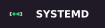

# gnilobaiter

**Software development since 2018** · **AI-assisted engineering since 2025**

## 👨‍💻 About Me

I've been building software **since 2018**, working across backend systems, web applications, automation, desktop utilities, and infrastructure. I care about architecture, maintainability, security, and how software behaves in production, not just whether it runs on my machine.

Since **2025**, I've used **OpenAI Codex** as an engineering tool for implementation, investigation, testing, and automation. I still design the systems, validate the decisions, review the code, and own the results. **AI-assisted engineering ≠ vibe coding.**

### 🔧 What I Build

- **Full-stack applications & SaaS:** React, Next.js, Vue, Nuxt, Astro, TypeScript/TSX, Tailwind CSS, and experience with Makerkit.
- **Backend & CRM platforms:** APIs, authentication, business logic, integrations, real-time systems, database-driven workflows, Alembic migrations, and database testing with pgTAP.
- **Automation & integrations:** bots, Telethon, aiogram, parsers, scheduled workers, Discord services, and browser automation with Playwright.
- **Infrastructure & delivery:** Linux servers, Nginx, systemd, MySQL, CI/CD, Cloudflare, Windows utilities, backups, and production operations.
- **AI & developer workflows:** Codex, VS Code, MCP, agent skills, local inference, and tooling around testing and code quality.
- **Games & modding:** games in Godot and Unity, Minecraft mods with Fabric, and plugins for Unity-based games.

---

## 💻 Tech Stack

### Programming Languages

### Frontend & Web

### Backend & Desktop

### Databases & ORM

### DevOps & Infrastructure

### Testing & Quality

### AI Agents & Developer Tools

### Machine Learning & Data

### Platforms & Other Tools

### Game Development & Modding

